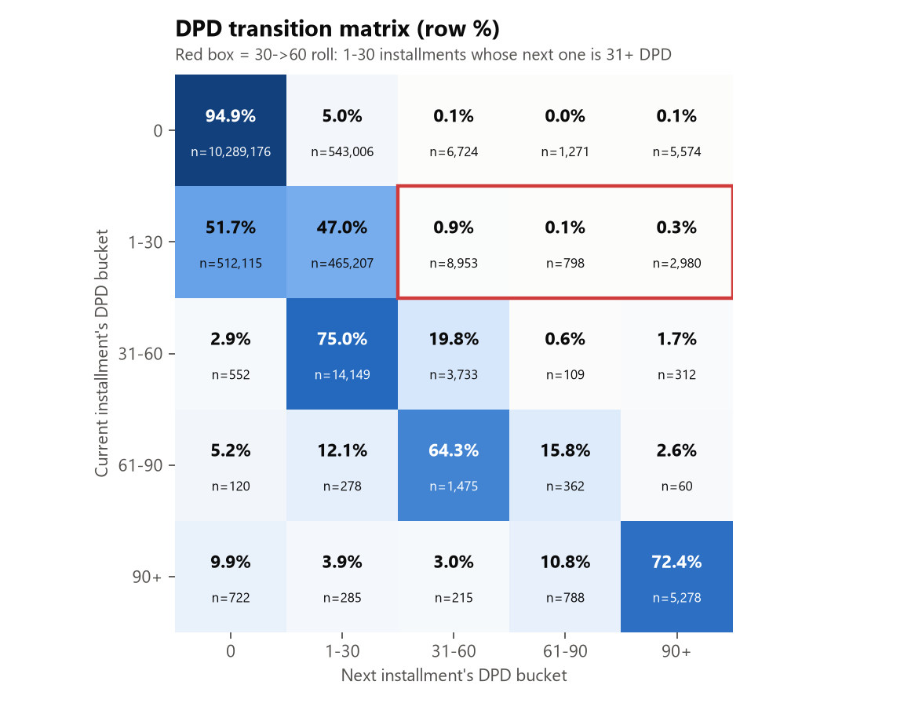
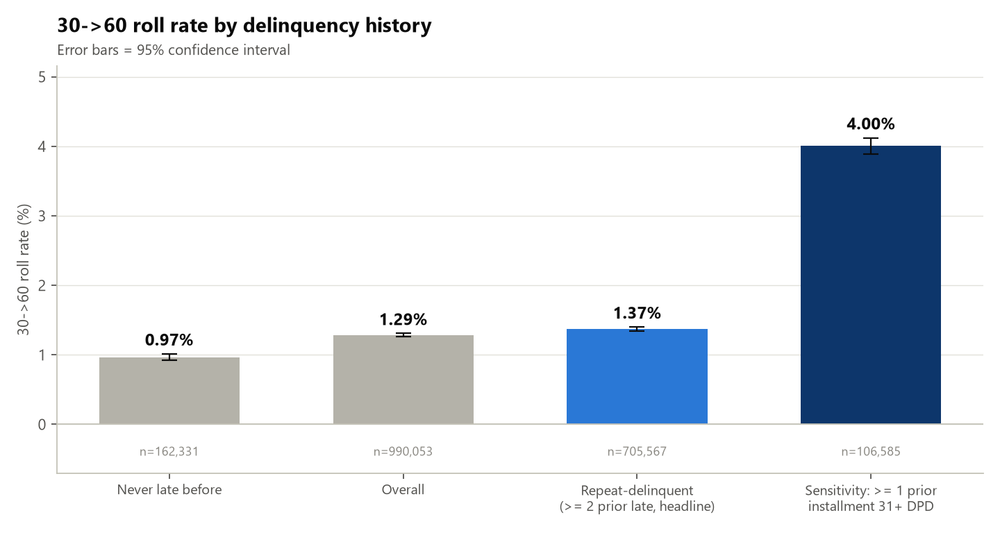

# Repayment & Collections Early-Warning Analytics

Descriptive and diagnostic analytics on **13.6M loan repayment records** (Home Credit Default Risk, Kaggle).
The project measures delinquency and DPD roll rates and tests which borrower segment should get early
collections intervention. SQL (DuckDB) holds all the logic; Python only orchestrates, exports and charts.

**Live dashboard:** `https://<your-vercel-url>.vercel.app` _(placeholder: update after deploying, see `web/README.md`)_

| Deliverable | Where |
|---|---|
| SQL pipeline (all business logic) | [`sql/`](sql/) |
| Every headline number, auto-generated | [`RESULTS.md`](RESULTS.md) |
| Excel MIS (formulas, heatmap, early-warning list) | `exports/collections_MIS.xlsx` |
| Power BI star schema + DAX + build guide | `exports/powerbi/`, [`powerbi/`](powerbi/) |
| Charts | [`reports/figures/`](reports/figures/) |
| Interview prep | [`INTERVIEW_NOTES.md`](INTERVIEW_NOTES.md) |
| Interactive web dashboard (Next.js, static) | [`web/`](web/) |

---

## 1. Problem

A collections team has limited capacity. It wants to know: **(1)** how healthy repayment is, **(2)** how
often early delinquency (1-30 days past due) gets worse, and **(3)** whether a simple, explainable
borrower segment, "repeat delinquents", rolls forward more often and so deserves earlier contact.

## 2. Data

| Table | Rows | Used for |
|---|---|---|
| `installments_payments.csv` | 13,605,401 payment rows | due date, payment date, scheduled and paid amounts |
| `previous_application.csv` | 1,670,214 loans | contract type, product, channel, credit amount, term, active flag |
| `application_train.csv` | 307,511 borrowers | income type, age, region rating, gender |

* 96.1% of installment loans match `previous_application`; 85.9% of installment borrowers match
  `application_train` (the rest are Kaggle *test-set* borrowers). Both joins are LEFT JOINs, and unmatched rows
  are labelled `Unknown` rather than dropped.
* All `DAYS_*` columns are **relative** to the borrower's current application date (day 0); there are no
  calendar dates.

## 3. The grain decision (and the trap it avoids)

`installments_payments` is **one row per payment, not per installment**. An installment
(`SK_ID_PREV + NUM_INSTALMENT_VERSION + NUM_INSTALMENT_NUMBER`) paid in three parts appears three times, each
row repeating the full scheduled amount:

| SK_ID_PREV | Inst. # | Due day | Paid day | AMT_INSTALMENT | AMT_PAYMENT |
|---|---|---|---|---|---|
| 1083675 | 11 | -484 | -512 | 16,020.45 | 292.50 |
| 1083675 | 11 | -484 | -482 | 16,020.45 | 12,267.00 |
| 1083675 | 11 | -484 | -477 | 16,020.45 | 3,460.95 |

* **640,905 installments (4.95%)** have more than one payment row (up to 12).
* A naive `SUM(AMT_INSTALMENT)` gives **231.98B** instead of the true **222.20B**: a **9.79B (+4.41%)
  overstatement**.
* Judged row by row, **7.85%** of payment rows look "partial". At the installment grain only **0.018%** of
  installments are really partially paid. Most split payments add up to the full amount.

**Decision:** the fact table (`sql/02_fact_installment.sql`) is one row per installment, with
`scheduled_amt = MAX(AMT_INSTALMENT)` (constant within the grain, verified) and `paid_amt = SUM(AMT_PAYMENT)`.
`src/checks.py` asserts that the grain is unique and that the scheduled total equals the deduplicated source.

## 4. Metric definitions

| Metric | Definition |
|---|---|
| DPD | `GREATEST(last_payment_day − due_day, 0)`. The **last** payment is used because that is when the installment was fully settled; the first of several split payments can be on time while the rest arrives late. The 2,905 installments with no payment at all are aged to day 0. |
| On-time % | installments with DPD = 0 **and** paid ≥ 99% of scheduled ÷ all installments |
| Coverage % | Σ paid ÷ Σ scheduled (above 100% because of prepayments) |
| Partial % | installments with 0 < paid/scheduled < 99% ÷ all installments |
| DPD buckets | 0, 1-30, 31-60, 61-90, 90+ |
| 30→60 roll rate | see the exact definition below |
| Repeat-delinquent | borrower has **≥ 2** late installments (DPD > 0, any of their loans) due **strictly before** the current installment |
| Outstanding (proxy) | active loans only (`DAYS_TERMINATION = 365243`): remaining installments × annuity. There are no balance snapshots in the data. |

**30→60 roll rate (word for word, identical to the comment in `sql/04_roll_rates.sql`):**

> The 30->60 roll rate is the share of installments in DPD bucket '1-30' whose NEXT installment on the same loan
> (ordered by NUM_INSTALMENT_NUMBER, latest NUM_INSTALMENT_VERSION per number) lands in DPD bucket '31-60' or
> worse ('31-60', '61-90' or '90+'). Installments with no next installment (the last one observed on a loan) are
> excluded from the denominator.

**No look-ahead:** the repeat-delinquency count uses
`SUM(is_late) OVER (PARTITION BY SK_ID_CURR ORDER BY due_day RANGE BETWEEN UNBOUNDED PRECEDING AND 1 PRECEDING)`,
so only installments due on earlier days are counted.

## 5. Key findings (real numbers from `RESULTS.md`)

| KPI | Value |
|---|---|
| Installment records | **12,951,918** (997,752 loans, 339,587 borrowers) |
| On-time payment rate | **91.44%** |
| Payment coverage | **105.53%** |
| Partial-payment rate | **0.018%** |
| DPD mix by count (0 / 1-30 / 31-60 / 61-90 / 90+) | 91.46% / 8.24% / 0.17% / 0.03% / 0.11% |
| DPD mix by amount | 92.89% / 6.99% / 0.08% / 0.01% / 0.03% |
| **Overall 30→60 roll rate** | **1.29%** (12,731 of 990,053) |
| Cure rate from 1-30 (next installment on time) | 51.73% |
| **Repeat-delinquent (≥2 prior late) 30→60 roll** | **1.37%** (95% CI 1.35%–1.40%) |
| Never-late 30→60 roll | 0.97% (95% CI 0.92%–1.01%) |
| Repeat vs not-repeat z-test | z = 12.2, p ≈ 5e-34 |
| Repeat segment size today | 73,234 borrowers, 93,635 active loans, 19.75B outstanding (49.8% of active book) |
| **Sensitivity: ≥1 prior installment 31+ DPD** | **4.00%** roll (3.1× overall, 4.2× everyone else) |
| Sensitivity segment size today | 10,838 borrowers, 13,621 active loans, 2.56B outstanding (6.5% of active book) |

What the numbers say:

1. **Repayment is healthy, and early lateness is mostly noise.** 8.5% of installments are late, but the median
   delay is 4 days, and half of 1-30 installments are followed by an on-time one. Only 1.29% roll to 31+ DPD.
2. **The specified repeat-delinquency segment is real but weak.** Its gap is statistically significant (z = 12.2),
   but the lift is only 1.07× overall, and it flags 71% of all early-delinquent installments. Thresholds 1 to 5
   all show the same picture (lift 1.03× to 1.07×). Being a few days late is too common to separate borrowers.
3. **Severity of past delinquency is the signal that matters.** Borrowers with at least one prior installment
   more than 30 days late roll at 4.00%, against 0.96% for everyone else. This group is 10.8% of at-risk
   installments, and the rate climbs with each additional severe episode (5.3% at ≥2, 7.4% at ≥5).
4. **Product mix drives roll rates more than demographics.** Consumer (POS) loans roll at 2.00% vs 0.70% for
   cash loans; loans under 50k roll at 2.63% vs 0.40% for 600k+. Age band and region rating barely move the
   rate (1.14% to 1.41%).

> **Resume note:** an earlier draft claimed "18.6% vs 11.2%". The pipeline does not reproduce those figures.
> The honest numbers are **1.37% vs 1.29%** for the specified segment (≥2 prior late), or **4.00% vs 1.29%** for
> the severe-history segment.

## 6. Recommendation

**Trigger early collections contact on a 1-30 DPD installment when the borrower has at least one prior
installment that was more than 30 days late.** Those accounts roll forward at 4.00% (3.1× the portfolio's
1.29%, z = 83). The flag is cheap to compute, has no look-ahead, and covers a workable queue: 10,838 borrowers,
13,621 active loans, 2.56B outstanding (6.5% of the active book).

Do **not** use "≥2 prior late installments (DPD > 0)" on its own. It would put half the active book (19.75B) into
the queue for only a 7% uplift in roll rate. Within the severe-history queue, contact consumer (POS) loans and
small-ticket loans first, since those products roll at about 2× the portfolio rate.

Next step before go-live: an A/B holdout (contact vs business-as-usual) on the severe-history segment to
measure the *incremental* reduction in roll rate, which this observational data cannot show.

## 7. How to run

```bash
# Python 3.11
python -m venv .venv && .venv/Scripts/activate      # Windows (macOS/Linux: source .venv/bin/activate)
pip install -r requirements.txt

# Data: put the three CSVs in data/raw/
#   kaggle competitions download -c home-credit-default-risk   (needs a Kaggle API token)
make all            # or: python src/run_pipeline.py
```

One run (~3 minutes on a laptop) converts the CSVs to Parquet (first run only), executes `sql/01`–`06`, runs
the data-quality checks, writes the Power BI CSVs, the Excel MIS and the charts, regenerates `RESULTS.md`, and
writes the web dashboard's JSON to `web/public/data/`. The pipeline stops if any check fails.

| Check (`src/checks.py`) | Result |
|---|---|
| Fact grain unique | 12,951,918 rows = 12,951,918 keys |
| No double-counted scheduled amount | 222.20B = deduplicated source |
| DPD bucket counts sum to total (and each segment dimension too) | pass |
| Each roll-matrix row sums to 100% | pass |
| 30→60 numerator/denominator agree across tables | pass |
| Power BI aggregates reconcile to the fact table | pass |

## 8. Repository layout

```
sql/        00_convert_parquet  01_profile  02_fact_installment  03_kpis
            04_roll_rates  05_repeat_delinquency  06_powerbi_model
src/        run_pipeline.py  checks.py  report.py  export_excel.py  export_powerbi.py
            export_web_json.py  charts.py  db.py
exports/    collections_MIS.xlsx  powerbi/*.csv
powerbi/    DAX_MEASURES.md  BUILD_GUIDE.md
reports/figures/   01_dpd_distribution.png  02_roll_rate_heatmap.png
                   03_roll_rate_by_segment.png  04_repeat_vs_overall.png
web/        Next.js static dashboard (reads web/public/data/*.json only)
```

## 9. Limitations

* **Relative days, no calendar.** There are no month-end snapshots, so "roll rate" here is installment-to-next-
  installment on the same loan, not the classic month-on-month bucket migration of a balance.
* **Installment-level, not balance-level, delinquency.** DPD is measured per installment from its own due date;
  a real collections system ages the oldest unpaid amount on the account.
* **Survivorship / selection.** These are *previous* loans of people who later applied again to Home Credit, so
  the worst defaulters (who never came back) are under-represented. Loans with no next installment (charged-off
  or closed) drop out of the roll-rate denominator.
* **Outstanding is a proxy** (remaining installments × annuity). Revolving lines have no schedule, so they only
  appear in the credit-amount column.
* **Observational.** Higher roll rates identify where to look; they do not prove that contact would reduce them.



